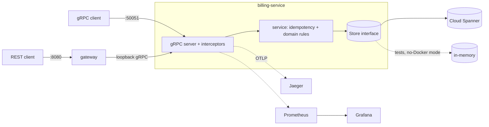

# billing-service

[](https://github.com/Rishi-creator-11/billing-service/actions/workflows/ci.yml)

Idempotent subscription billing in Go. gRPC API with a REST gateway, a double-entry ledger, and Cloud Spanner storage, tested against the official Spanner emulator.

## Problem

Clients retry, queues redeliver, and load balancers replay requests during deploys, so the same charge request often arrives more than once. If each arrival is treated as new, the customer is charged twice.

Here, a charge or refund with a given idempotency key takes effect at most once, however often or concurrently it is sent. Every money movement is also written to an append-only, balanced ledger in the same transaction.

## Features

- Customers and subscriptions with a validated state machine.
- `ChargeInvoice` and `RefundCharge` (partial refunds), both requiring an `idempotency_key`.
- Double-entry ledger: each charge and refund posts a debit and a credit that sum to zero.
- Money as integer minor units plus an ISO 4217 code. No floats.
- gRPC status codes with machine-readable error reasons, deadlines, health checks, reflection, graceful shutdown.
- API-key auth, structured logs, Prometheus metrics, OpenTelemetry traces, Grafana dashboard.

Payment authorization sits behind a `Processor` interface. The default implementation is deterministic: it declines the payment method `pm_decline` and approves everything else, which keeps the decline path and the `PAST_DUE` transition testable.

## Architecture



The REST gateway calls the gRPC server over loopback, so both protocols share the same auth, logging and logic.

## API

Contract: [`proto/billing/v1/billing.proto`](proto/billing/v1/billing.proto).

| RPC | REST |
|---|---|
| `CreateCustomer` | `POST /v1/customers` |
| `CreateSubscription` | `POST /v1/subscriptions` |
| `GetSubscription` | `GET /v1/subscriptions/{id}` |
| `CancelSubscription` | `POST /v1/subscriptions/{id}:cancel` |
| `ChargeInvoice` | `POST /v1/charges` |
| `RefundCharge` | `POST /v1/charges/{id}/refunds` |
| `GetLedger` | `GET /v1/customers/{id}/ledger` |
| `GetBalance` | `GET /v1/customers/{id}/balance` |

Auth: `authorization: Bearer <key>` or `x-api-key: <key>`. The local stack uses `dev-local-key`.

Errors: `INVALID_ARGUMENT`, `NOT_FOUND`, `ALREADY_EXISTS`, `FAILED_PRECONDITION`, `UNAUTHENTICATED`, `DEADLINE_EXCEEDED`, `INTERNAL`, each with a `google.rpc.ErrorInfo` reason such as `IDEMPOTENCY_KEY_REUSED`.

### Example

Send the same charge twice. The second response is the original charge with `idempotentReplay: true`:

```console
$ grpcurl -plaintext -H 'authorization: Bearer dev-local-key' -d '{
    "idempotency_key": "inv-2026-11-ada",
    "customer_id": "<customer-id>",
    "subscription_id": "<subscription-id>",
    "invoice_id": "inv-2026-11",
    "amount": {"amount_minor": 1999, "currency_code": "USD"},
    "payment_method_id": "pm_card_visa"
  }' localhost:50051 billing.v1.BillingService/ChargeInvoice
{ "charge": { "id": "621142e3-...", "status": "CHARGE_STATUS_SUCCEEDED", ... } }

# same command again
{ "charge": { "id": "621142e3-...", ... }, "idempotentReplay": true }
```

Same key with a different amount is rejected:

```console
Code: FailedPrecondition
Message: idempotency_key "inv-2026-11-ada" was already used with a different request; use a new key for a new request
reason: IDEMPOTENCY_KEY_REUSED
```

Over REST, `int64` fields such as `amount_minor` are JSON strings (protobuf JSON mapping). `make demo` runs the full flow.

## How it works

### Idempotency

Each keyed request runs in one serializable transaction:

1. Look up the key. If found and the request fingerprint (hash of method and request fields) matches, return the stored response. If it differs, fail with `FAILED_PRECONDITION`.
2. Otherwise validate, perform the operation, and post the ledger entries.
3. Store the response under the key in the same transaction.

Decisions:

- **No "in progress" state.** The effects and the key commit together, so there is no charge without its key and no key without its charge. Concurrent duplicates conflict on the key row; one commits and the rest replay. No locks, leases or expiry.
- **Only successful outcomes are recorded.** A validation error leaves no record, so the client can fix the request and retry with the same key. A decline is a business outcome: it is returned as `DECLINED`, recorded, and replayed.
- **A reused key with a different request is an error**, not a silent replay. That usually means a client bug, such as a wrong amount.
- **Keys are global and bound to one method.** A charge key cannot be reused for a refund.
- The store contract is serializable read-write transactions. Spanner provides it natively; the in-memory store uses an exclusive lock. Transaction functions must be safe to re-run.

### Ledger

A charge posts `DEBIT assets:cash` and `CREDIT revenue:subscriptions`; a refund posts the reverse. Both entries share a `transaction_id` and commit with the charge. Entries are never updated. `GetBalance` sums entries per account, so each customer's balances always add to zero.

### Subscription states

| From | Payment succeeds | Payment declined | Cancel |
|---|---|---|---|
| `PENDING` | `ACTIVE` | `PENDING` | `CANCELED` |
| `ACTIVE` | `ACTIVE` | `PAST_DUE` | `CANCELED` |
| `PAST_DUE` | `ACTIVE` | `PAST_DUE` | `CANCELED` |
| `CANCELED` | rejected | rejected | no-op |

## Run

Requires Docker with Compose. Go is needed for `make demo` and tests.

```console
make up      # Spanner emulator, service, Prometheus, Grafana, Jaeger
make demo    # walk through the API
make down    # stop and delete everything
```

| Service | URL |
|---|---|
| gRPC | `localhost:50051` |
| REST | http://localhost:8080 |
| Metrics, `/healthz`, `/readyz` | http://localhost:9091 |
| Prometheus | http://localhost:9090 |
| Grafana (dashboard "Billing service") | http://localhost:3000 |
| Jaeger | http://localhost:16686 |

Without Docker, run on the in-memory store (data is lost on restart):

```console
BILLING_STORE=memory BILLING_API_KEYS=dev-local-key go run ./cmd/billing-server
```

Configuration is by environment variable: `BILLING_GRPC_ADDR`, `BILLING_HTTP_ADDR`, `BILLING_ADMIN_ADDR`, `BILLING_STORE` (`spanner` or `memory`), `SPANNER_DATABASE`, `BILLING_AUTO_CREATE_DB`, `BILLING_API_KEYS`, `LOG_LEVEL`, and the standard `OTEL_EXPORTER_OTLP_*` variables. The server refuses to start without API keys unless `BILLING_AUTH_DISABLED=true`.

## Testing

```console
make emulator   # start the Spanner emulator
make test       # go test -race ./...
make lint       # buf lint, go vet, golangci-lint
make bench
```

103 tests and subtests pass with `-race`, none skipped. They cover:

- One conformance suite run against both the in-memory store and the Spanner emulator, including a serializability check.
- Replay, key reuse, concurrent refunds that never exceed the charge, declines, and an injected failure proving the charge, state change and key roll back together.
- 50 parallel duplicate requests producing exactly one charge and two ledger entries.
- A ledger invariant asserted after every scenario: entries sum to zero.
- End-to-end tests of gRPC, REST, auth, health, reflection, `/metrics` and graceful shutdown.

CI runs the emulator as a service container and fails on any skipped test, plus `buf lint`, `buf format`, `buf breaking` on pull requests, `go vet`, golangci-lint and a Docker build.

## Observability

- **Metrics** (`:9090/metrics`, host port 9091): request count and latency by method and code, in-flight requests, charge outcomes, idempotent replays and key conflicts.
- **Traces**: every RPC is traced, and each idempotent transaction has a span with a `billing.idempotent_replay` attribute.
- **Logs**: one JSON line per RPC with method, status code, duration and `request_id`. Free-text error messages are not logged because they can contain caller data such as emails.

## Layout

```text
proto/billing/v1/       API contract
gen/billing/v1/         generated code (make proto)
cmd/                    billing-server, demo, loadtest
internal/billing/       domain: state machine, ledger postings (no I/O)
internal/service/       RPC handlers, idempotency
internal/store/         Store interface; memory/, spanner/ (with schema.sql), storetest/
internal/interceptor/   request id, recovery, logging, metrics, deadline, auth
internal/app/           gRPC, gateway, health, shutdown wiring
deploy/                 Prometheus and Grafana config
```

## Performance

Apple M1 Pro, Colima (4 vCPU, 6 GB), Cloud Spanner emulator, load generator on the host.

| Run (16 workers, 15 s) | Requests | Throughput | p50 | p95 | p99 |
|---|---|---|---|---|---|
| Unique keys | 9,462 | 615 req/s | 3.1 ms | 100 ms | 280 ms |
| Each key sent 4 times concurrently | 13,237 (9,927 replays) | 875 req/s | 3.4 ms | 72 ms | 173 ms |

Both runs had zero errors. Service-layer benchmark on the in-memory store: about 4,900 ns/op for a new charge and 1,500 ns/op for a replay (`make bench`).

Reproduce with `make load ARGS="-c 16 -d 15s"` and `make load ARGS="-c 16 -d 15s -dupes 4"`.
