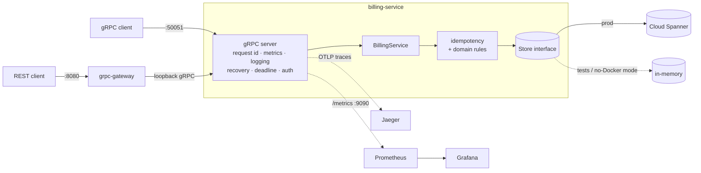

# billing-service

An idempotent subscription billing service in Go. gRPC API with a REST/JSON gateway, a double-entry ledger, and Cloud Spanner storage (tested against the official Spanner emulator).

## The problem

In subscription billing, the same charge request routinely arrives more than once: a client times out and retries, a message queue redelivers, a load balancer replays a request during a deploy. If the service treats each arrival as new, the customer is charged twice. This service makes that impossible by construction: a charge or refund carrying a given idempotency key takes effect at most once, no matter how many times, or how concurrently, it is sent. Every money movement is also recorded as balanced debit and credit entries in an append-only ledger, written in the same transaction as the charge.

## What it does

- **Customers and subscriptions** with a validated state machine (`PENDING`, `ACTIVE`, `PAST_DUE`, `CANCELED`).
- **ChargeInvoice** and **RefundCharge**, both requiring an `idempotency_key`. Same key and same request returns the original result. Same key with a different request fails with `FAILED_PRECONDITION`. Concurrent duplicates produce exactly one charge.
- **Double-entry ledger**: every charge and refund posts a debit and a credit that sum to zero, atomically with the charge.
- **GetLedger / GetBalance** per customer, with pagination.
- Money is integer minor units plus an ISO 4217 currency code. No floats anywhere.
- Correct gRPC status codes, client deadlines honored end to end, graceful shutdown, `grpc.health.v1`, server reflection.
- Interceptors for request IDs, structured logging (`slog`), panic recovery, metrics, a default deadline, and API-key auth.
- Prometheus metrics, OpenTelemetry tracing, a provisioned Grafana dashboard.

Payment authorization is simulated by a small `Processor` interface: the built-in implementation declines the payment method `pm_decline` and approves everything else. It exists so the decline path, the `PAST_DUE` transition and decline replay are real and tested; there is no integration with a real payment network.

## Architecture



The REST gateway calls the gRPC server over loopback, so REST and gRPC traffic go through exactly the same interceptors and logic.

## API overview

The contract is `proto/billing/v1/billing.proto`.

| RPC | REST | Notes |
|---|---|---|
| `CreateCustomer` | `POST /v1/customers` | email is unique |
| `CreateSubscription` | `POST /v1/subscriptions` | starts `PENDING` |
| `GetSubscription` | `GET /v1/subscriptions/{id}` | |
| `CancelSubscription` | `POST /v1/subscriptions/{id}:cancel` | naturally idempotent |
| `ChargeInvoice` | `POST /v1/charges` | `idempotency_key` required |
| `RefundCharge` | `POST /v1/charges/{id}/refunds` | `idempotency_key` required, partial refunds allowed |
| `GetLedger` | `GET /v1/customers/{id}/ledger` | `page_size`, `page_token` |
| `GetBalance` | `GET /v1/customers/{id}/balance` | per-account balances and net collected |

Authentication: `authorization: Bearer <key>` or `x-api-key: <key>` metadata/header. The local stack uses `dev-local-key`. Health and reflection are open.

Status codes: `INVALID_ARGUMENT` (bad input), `NOT_FOUND`, `ALREADY_EXISTS` (duplicate customer email), `FAILED_PRECONDITION` (idempotency key reuse with a different payload, charging a canceled subscription, refunding more than remains, currency mismatch), `UNAUTHENTICATED`, `DEADLINE_EXCEEDED`, `INTERNAL`. Errors carry a `google.rpc.ErrorInfo` with a machine-readable `reason` such as `IDEMPOTENCY_KEY_REUSED`.

### grpcurl (real output from the running stack)

```console
$ grpcurl -plaintext localhost:50051 list
billing.v1.BillingService
grpc.health.v1.Health
grpc.reflection.v1.ServerReflection
grpc.reflection.v1alpha.ServerReflection

$ grpcurl -plaintext -H 'authorization: Bearer dev-local-key' \
    -d '{"email":"ada@example.com","name":"Ada Lovelace"}' \
    localhost:50051 billing.v1.BillingService/CreateCustomer
{
  "customer": {
    "id": "10a09498-47bb-4514-8311-424c90b3ed35",
    "email": "ada@example.com",
    "name": "Ada Lovelace",
    "createTime": "2026-11-19T07:59:12.297661174Z"
  }
}

$ grpcurl -plaintext -H 'authorization: Bearer dev-local-key' \
    -d '{"customer_id":"10a09498-47bb-4514-8311-424c90b3ed35","plan_id":"pro-monthly","price":{"amount_minor":1999,"currency_code":"USD"},"interval":"BILLING_INTERVAL_MONTHLY"}' \
    localhost:50051 billing.v1.BillingService/CreateSubscription
```

Charge, then send the identical request again. The second response is the same charge, flagged as a replay:

```console
$ grpcurl -plaintext -H 'authorization: Bearer dev-local-key' -d '{
    "idempotency_key": "inv-2026-11-ada",
    "customer_id": "10a09498-47bb-4514-8311-424c90b3ed35",
    "subscription_id": "f36f22ff-d11b-4599-95e6-47404a9fdcbb",
    "invoice_id": "inv-2026-11",
    "amount": {"amount_minor": 1999, "currency_code": "USD"},
    "payment_method_id": "pm_card_visa"
  }' localhost:50051 billing.v1.BillingService/ChargeInvoice
{
  "charge": {
    "id": "621142e3-117b-4b8b-87a3-f321ddbc34c2",
    "status": "CHARGE_STATUS_SUCCEEDED",
    "amount": { "amountMinor": "1999", "currencyCode": "USD" },
    ...
  }
}
# same command again:
{
  "charge": { "id": "621142e3-117b-4b8b-87a3-f321ddbc34c2", ... },
  "idempotentReplay": true
}
```

Same key, different amount:

```console
ERROR:
  Code: FailedPrecondition
  Message: idempotency_key "inv-2026-11-ada" was already used with a different request; use a new key for a new request
  Details:
  1)	{
    	  "@type": "type.googleapis.com/google.rpc.ErrorInfo",
    	  "domain": "billing.v1",
    	  "reason": "IDEMPOTENCY_KEY_REUSED"
    	}
```

### curl (real output from the running stack)

```console
$ curl -s -X POST localhost:8080/v1/charges/621142e3-117b-4b8b-87a3-f321ddbc34c2/refunds \
    -H 'authorization: Bearer dev-local-key' -H 'content-type: application/json' \
    -d '{"idempotency_key":"refund-ada-1","amount":{"amount_minor":500,"currency_code":"USD"},"reason":"goodwill credit"}'
{"refund":{"id":"94250746-2592-4f87-ae6c-1e9b06defef9","charge_id":"621142e3-...","amount":{"amount_minor":"500","currency_code":"USD"},"reason":"goodwill credit",...},"charge":{...,"status":"CHARGE_STATUS_PARTIALLY_REFUNDED","refunded":{"amount_minor":"500","currency_code":"USD"},...},"idempotent_replay":false}

$ curl -s localhost:8080/v1/customers/10a09498-47bb-4514-8311-424c90b3ed35/balance \
    -H 'authorization: Bearer dev-local-key'
{"customer_id":"10a09498-...","balances":[{"account":"assets:cash","balance":{"amount_minor":"1499","currency_code":"USD"}},{"account":"revenue:subscriptions","balance":{"amount_minor":"-1499","currency_code":"USD"}}],"net_collected":[{"amount_minor":"1499","currency_code":"USD"}]}

$ curl -s -i -X POST localhost:8080/v1/charges ...   # same key, amount changed to 2999
HTTP/1.1 400 Bad Request
{"code":9,"message":"idempotency_key \"inv-2026-11-ada\" was already used with a different request; use a new key for a new request","details":[{"@type":"type.googleapis.com/google.rpc.ErrorInfo","reason":"IDEMPOTENCY_KEY_REUSED","domain":"billing.v1","metadata":{}}]}

$ curl -s -i localhost:8080/v1/customers/x/balance
HTTP/1.1 401 Unauthorized
```

Over REST (protobuf JSON), `int64` fields such as `amount_minor` are strings, per the protobuf JSON mapping.

## How it works

### Idempotency

Each keyed request runs inside one serializable store transaction that does three things:

1. Look up the key. If a record exists, compare its fingerprint (a hash of the method and the request fields) to this request. Equal: return the stored response with `idempotent_replay=true`. Different: fail with `FAILED_PRECONDITION`.
2. If there is no record, perform the operation: validate against the subscription, move the subscription state, insert the charge, post the ledger entries.
3. Store the response under the key, in the same transaction.

Design decisions:

- **No "in progress" state.** The effects and the key record commit atomically, so there is never a committed charge without its key, and never a key without its charge. Concurrent duplicates conflict on the key row; the store serializes them, one commits, and the others re-run, find the record and replay. There is no lock table, lease or expiry to get wrong, and a crash at any point leaves either everything or nothing.
- **The store contract is "serializable read-write transactions".** Spanner provides this natively and retries aborted transactions; the in-memory store takes an exclusive, context-aware lock. Transaction functions must therefore be safe to re-run, which is why the simulated processor is side-effect free. A real gateway call would need the idempotency key forwarded to the gateway rather than being made inside the transaction.
- **Only successful outcomes are recorded.** A validation error or failed precondition leaves no record, so the client can fix the request and retry with the same key. A decline is a business outcome, not an error: it is returned as `status=DECLINED`, recorded, and replayed like any other result.
- **Same key, different request is an error, not a silent replay.** Returning the old result for a changed payload would hide a client bug, which in billing usually means the wrong amount.
- **Keys are global and bound to one method.** Reusing a charge key for a refund is rejected.
- Cancelling a subscription is naturally idempotent (cancelling a canceled subscription is a no-op), so it needs no key.

### Ledger

Each charge posts `DEBIT assets:cash` and `CREDIT revenue:subscriptions`; each refund posts the reverse. The two entries share a `transaction_id` and are written in the same transaction as the charge, so the ledger cannot drift from the charge table. Entries are append-only and are never updated.

`GetBalance` sums entries per account (debits positive, credits negative), so for each customer and currency the balances always add to zero, and `net_collected` is charges minus refunds. Balances are computed on read rather than stored as running totals; that keeps a single source of truth at the cost of read work proportional to a customer's entries.

### Subscription state machine

| From | Payment succeeded | Payment declined | Cancel |
|---|---|---|---|
| `PENDING` | `ACTIVE` | `PENDING` | `CANCELED` |
| `ACTIVE` | `ACTIVE` | `PAST_DUE` | `CANCELED` |
| `PAST_DUE` | `ACTIVE` | `PAST_DUE` | `CANCELED` |
| `CANCELED` | rejected | rejected | no-op |

Charging a canceled subscription fails with `FAILED_PRECONDITION`.

### Spanner schema

`Customers` (unique index on email), `Subscriptions`, `Charges`, `Refunds`, `IdempotencyKeys` (keyed by the idempotency key) and `LedgerEntries`, whose primary key is `(customer_id, create_time, entry_id)` so a customer's ledger is a contiguous, ordered key range and pagination is a range scan from a cursor. See `internal/store/spanner/schema.sql`. With `BILLING_AUTO_CREATE_DB=true` (set in the compose file) the service creates the instance, database and schema at startup.

## Quick start

Requires Docker with Compose, and Go for the demo and tests.

```console
make up      # builds the image, starts Spanner emulator, service, Prometheus, Grafana, Jaeger
make demo    # walks through the API against the running stack
make down    # stop and delete everything
```

| What | Where |
|---|---|
| gRPC | `localhost:50051` (API key `dev-local-key`) |
| REST gateway | http://localhost:8080 |
| Service metrics / health | http://localhost:9091/metrics, `/healthz`, `/readyz` |
| Prometheus | http://localhost:9090 |
| Grafana (dashboard "Billing service") | http://localhost:3000 |
| Jaeger | http://localhost:16686 |
| Spanner emulator | `localhost:9010` (gRPC), `localhost:9020` (REST) |

Without Docker the service runs on the in-memory store (data is lost on restart):

```console
BILLING_STORE=memory BILLING_API_KEYS=dev-local-key go run ./cmd/billing-server
```

Configuration is by environment variable: `BILLING_GRPC_ADDR`, `BILLING_HTTP_ADDR`, `BILLING_ADMIN_ADDR`, `BILLING_STORE` (`spanner` or `memory`), `SPANNER_DATABASE`, `BILLING_AUTO_CREATE_DB`, `BILLING_API_KEYS` (comma separated), `LOG_LEVEL`, and the standard `OTEL_EXPORTER_OTLP_*` variables. The server refuses to start without API keys unless `BILLING_AUTH_DISABLED=true`.

### Demo output

`make demo` (abridged, from a real run against the Spanner emulator):

```text
== 3. Charge the first invoice
charge 9fff5ab3-... status=CHARGE_STATUS_SUCCEEDED idempotent_replay=false

== 4. Client times out and retries with the SAME key
charge 9fff5ab3-... status=CHARGE_STATUS_SUCCEEDED idempotent_replay=true
same charge id returned: no second charge

== 5. Same key, different amount is rejected
code=FailedPrecondition message="idempotency_key \"demo-...-invoice-1\" was already used with a different request; use a new key for a new request"

== 6. 50 concurrent requests with one new key
requests=50 distinct charge ids=1 requests that created the charge=1

== 7. Partially refund the second charge ($5.00), then retry the refund
refund ba766bca-... charge status=CHARGE_STATUS_PARTIALLY_REFUNDED refunded=500
retry  ba766bca-... idempotent_replay=true (same refund id: true)

== 8. Ledger
account                  dir      amount
assets:cash              DEBIT      1999
revenue:subscriptions    CREDIT     1999
revenue:subscriptions    CREDIT     1999
assets:cash              DEBIT      1999
assets:cash              CREDIT      500
revenue:subscriptions    DEBIT       500
6 entries, signed sum (debits - credits) = 0

demo complete: 2 charges and 1 refund were applied exactly once
```

## Testing

```console
make emulator   # start only the Spanner emulator
make test       # go test -race ./...  (uses the emulator if it is reachable, otherwise skips those tests)
make lint       # buf lint, go vet, golangci-lint
make bench      # service-layer benchmarks
```

- **Store conformance suite** (`internal/store/storetest`) runs identically against the in-memory store and the Spanner emulator: CRUD round trips, unique email, ledger pagination, rollback, read-only enforcement, and a serializability check where 25 concurrent read-modify-write transactions must not lose an update.
- **Service tests** run against both stores. They cover replay, key reuse with a changed payload or across methods, **50 parallel duplicate requests producing exactly one charge and two ledger entries**, concurrent refunds that must never exceed the charge, declines, cancellation, validation tables, pagination, and an injected ledger-write failure proving the charge, state change and idempotency key roll back together.
- **Ledger invariant**: after every scenario the test asserts each transaction, each customer's ledger and the whole ledger sum to zero.
- **End-to-end tests** (`internal/app`) start the real servers on ephemeral ports and exercise gRPC with auth, deadlines and request IDs, REST, health, reflection, `/metrics`, and graceful shutdown with a request in flight.
- Table-driven tests for the state machine, money validation and auth.

A full run with the emulator up executes 102 passing tests/subtests with `-race`, no failures and no skips. CI (`.github/workflows/ci.yml`) runs the emulator as a service container and fails if any test is skipped, plus `buf lint`, `buf format`, `buf breaking` on pull requests, `go vet`, golangci-lint and a Docker build.

## Observability

- **Metrics** at `:9090/metrics` (host port 9091 in compose): `billing_grpc_requests_total{method,code}`, `billing_grpc_request_duration_seconds` (histogram), `billing_grpc_requests_in_flight`, `billing_charge_outcomes_total{outcome}` (`succeeded`, `declined`, `replayed`, `key_conflict`, `rejected`), `billing_idempotent_replays_total{method}`, `billing_idempotency_key_conflicts_total{method}`, plus Go runtime and process metrics.
- **Grafana** has a provisioned "Billing service" dashboard: request rate by method, error rate by code, latency percentiles, charge outcomes, replays, key conflicts, in-flight requests.
- **Tracing**: `otelgrpc` instruments every RPC and each idempotent transaction has its own span with a `billing.idempotent_replay` attribute. Spans export over OTLP to Jaeger in compose when `OTEL_EXPORTER_OTLP_ENDPOINT` is set.
- **Logs**: one JSON line per RPC with method, status code, duration, peer, `request_id` and, for errors, the machine-readable `reason`. Free-text error messages are deliberately not logged, because they can echo caller-supplied values such as email addresses. The request ID is accepted from or returned in the `x-request-id` header.

## Project layout

```text
proto/billing/v1/        API contract (buf lint / buf breaking configured in buf.yaml)
gen/billing/v1/          generated Go, gRPC and gateway code (make proto)
cmd/billing-server/      service entry point
cmd/demo/                API walkthrough client
cmd/loadtest/            load generator
internal/billing/        domain: entities, state machine, ledger postings (no I/O)
internal/service/        RPC handlers and the idempotency wrapper
internal/store/          Store interface
  memory/                in-memory implementation
  spanner/               Cloud Spanner implementation and schema.sql
  storetest/             conformance suite shared by both
internal/interceptor/    request id, recovery, logging, metrics, deadline, auth
internal/app/            wiring: gRPC, gateway, health, reflection, shutdown
internal/metrics/        Prometheus instruments
internal/telemetry/      OpenTelemetry setup
deploy/                  Prometheus config, Grafana provisioning and dashboard
Dockerfile               multi-stage, distroless, non-root
docker-compose.yml       emulator, service, Prometheus, Grafana, Jaeger
```

## Measured results

Machine: Apple M1 Pro. The stack ran in Colima (4 vCPU, 6 GB) with the Cloud Spanner **emulator**, so these numbers describe this service on the emulator, not on Cloud Spanner. The load generator ran on the host, over loopback.

Service layer on the in-memory store (no network, no disk):

```console
$ make bench
BenchmarkChargeInvoiceUniqueKeys-8     584906     4589 ns/op    4787 B/op    44 allocs/op
BenchmarkChargeInvoiceReplay-8        1543129     1512 ns/op    1368 B/op    26 allocs/op
```

End-to-end over gRPC against the stack from `make up` (Spanner emulator), 16 workers spread over 16 customers, 15 seconds each:

```console
$ make load ARGS="-c 16 -d 15s"
requests=8774 ok=8774 errors=0 replays=0
throughput=580 req/s
latency p50=3.57ms p95=109.47ms p99=297.96ms max=4.29987s

$ make load ARGS="-c 16 -d 15s -dupes 4"     # every key is sent 4 times, concurrently
requests=15246 ok=15246 errors=0 replays=11434
throughput=1014 req/s
latency p50=2.82ms p95=63.38ms p99=145.53ms max=1.01373s
```

In the second run 11,434 of 15,246 requests were replays (about three quarters, as expected), so each key was charged once and answered from the stored record the other three times.
